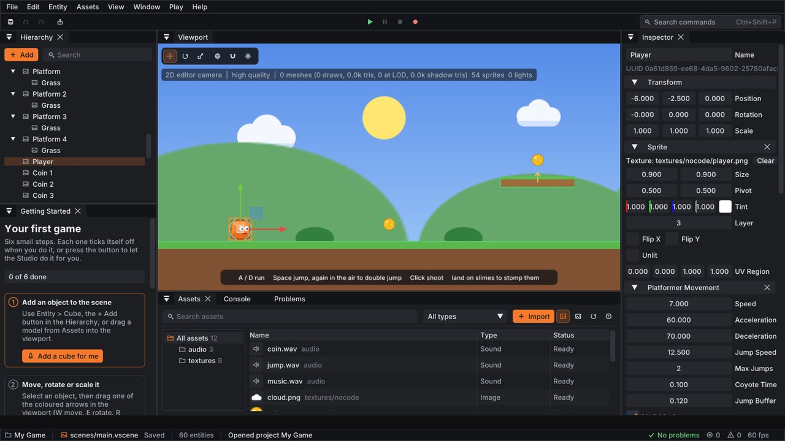
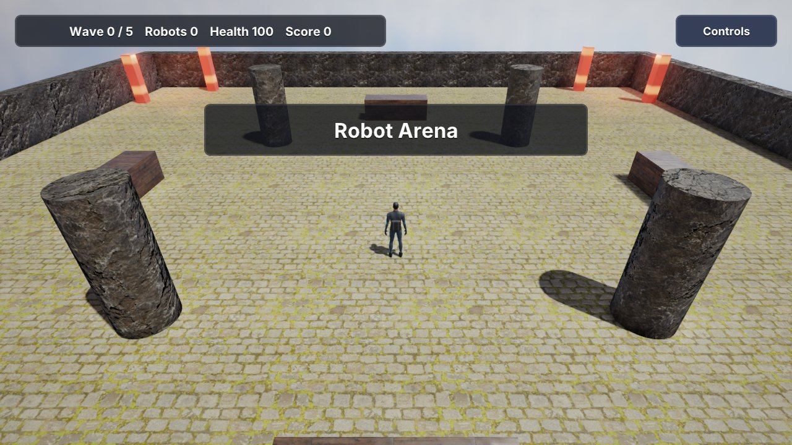
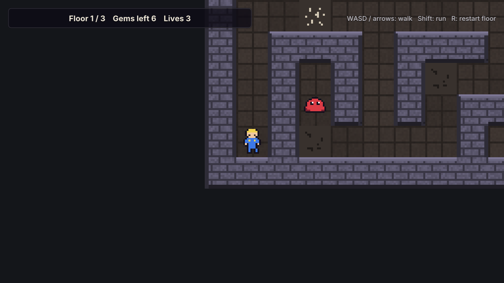
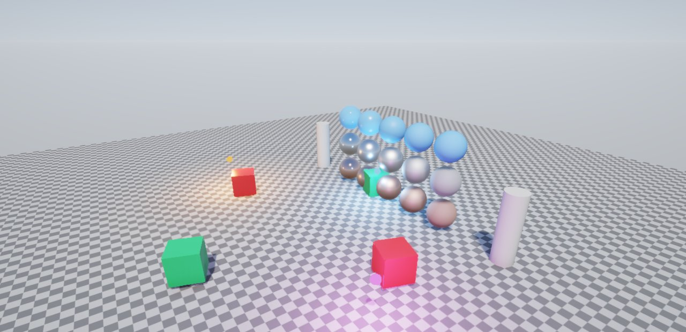
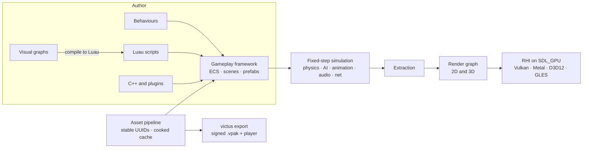

<a id="readme-top"></a>

<p align="center">
  
</p>

<p align="center">
  <picture>
    <source media="(prefers-color-scheme: dark)" srcset="./assets/readme/tagline-dark.svg" />
    
  </picture>
</p>

<p align="center">
  <b>VICTUS is an independent, open-source C++20 engine and editor for complete 2D and 3D games.</b><br>
  VICTUS Studio lets a first-time creator finish a game from ready-made Behaviours, and the engine underneath<br>
  covers PBR rendering, Jolt and Box2D physics, AI, animation, audio, multiplayer and one-command export.
</p>

<p align="center">
  <a href="https://github.com/FAHTHIZ/VICTUS/actions/workflows/ci.yml"></a>
  <a href="tests/"></a>
  <a href="CMakeLists.txt"></a>
  <a href="LICENSE"></a>
  <br>
  <a href="docs/RENDERING_SPEC.md"></a>
  <a href="docs/PLATFORM_SUPPORT.md"></a>
  <a href="docs/ARCHITECTURE.md"></a>
  <br>
  <a href="#behaviours"></a>
  <a href="docs/SCRIPT_API.md"></a>
  <a href="docs/NETWORKING_SPEC.md"></a>
  <a href="#samples"></a>
  <br>
  <a href="docs/TECHNOLOGY_DECISIONS.md"></a>
  <a href="docs/"></a>
  <a href="SECURITY.md"></a>
  <a href="CONTRIBUTING.md"></a>
  <a href="https://github.com/FAHTHIZ/VICTUS/stargazers"></a>
</p>

<p align="center">
  <a href="#quickstart"><b>Quickstart</b></a> &nbsp;·&nbsp;
  <a href="#your-first-game-in-five-minutes"><b>First game in five minutes</b></a> &nbsp;·&nbsp;
  <a href="#why-victus">Why</a> &nbsp;·&nbsp;
  <a href="#behaviours">Behaviours</a> &nbsp;·&nbsp;
  <a href="#whats-inside">Features</a> &nbsp;·&nbsp;
  <a href="#samples">Samples</a> &nbsp;·&nbsp;
  <a href="#how-it-works">How it works</a> &nbsp;·&nbsp;
  <a href="#status">Status</a> &nbsp;·&nbsp;
  <a href="#documentation">Docs</a>
</p>

<p align="center">
  <picture>
    <source media="(prefers-color-scheme: dark)" srcset="./assets/readme/stats-dark.svg" />
    
  </picture>
</p>

<details>
<summary><b>Table of contents</b></summary>

<br>

- [What is VICTUS?](#what-is-victus) · [See it](#see-it)
- [Quickstart](#quickstart) · [Your first game in five minutes](#your-first-game-in-five-minutes)
- [Why VICTUS](#why-victus) · [Behaviours](#behaviours) · [What's inside](#whats-inside)
- [Templates](#templates) · [Samples](#samples)
- [How it works](#how-it-works) · [How it compares](#how-it-compares)
- [Status](#status) · [Known limitations](#known-limitations)
- [Documentation](#documentation) · [Repository layout](#repository-layout)
- [Contributing](#contributing) · [License](#license)

</details>

<p align="center"><picture><source media="(prefers-color-scheme: dark)" srcset="./assets/readme/divider-dark.svg"></picture></p>

## What is VICTUS?

**VICTUS is a general-purpose game engine with its own editor, VICTUS Studio.** It is built so the whole product workflow, from a new project through gameplay authoring, testing, packaging and distribution, happens in one tool, for 2D and 3D alike. 2D is a first-class workflow, not a reduced 3D mode.

You can make a game three ways and mix them freely: drop ready-made **Behaviours** onto objects with no code at all, write **Luau** scripts or **visual graphs** when you want custom logic, or extend the engine in **C++** and native plugins.

<kbd>32</kbd> engine modules · <kbd>15</kbd> no-code Behaviours · <kbd>6</kbd> templates · <kbd>4</kbd> finished sample games · <kbd>4</kbd> GPU backends · <kbd>4</kbd> target platforms · <kbd>1,242</kbd> test cases

| | |
|---|---|
| **No code required** | Behaviours cover movement, enemies, pickups, health, checkpoints, score and HUD. One click turns any object into a Player, Enemy, Coin or Door |
| **Code when you want it** | Sandboxed Luau with hot reload and a debugger, node-based visual scripting that compiles to Luau, and a C++ API with a versioned C plugin ABI |
| **Photoreal, scaled to the device** | Clustered PBR with clear coat, sheen, anisotropy and subsurface layers, baked lightmaps, IBL, SSR, volumetrics and temporal upscaling, with tiers from phones to desktops |
| **A real editor** | Hierarchy, inspector, gizmos, undo, asset browser, material graphs, terrain tools, sequencer, behaviour-tree editor, profiler and play-in-editor with networked clients |
| **Ship it** | `victus export` builds compressed, signed `.vpak` packs and a standalone player. Android packaging, crash reports and validation are built in |
| **Evidence, not claims** | Every change is recorded in [STATUS.md](docs/STATUS.md) with the commands and results that verified it, and every architectural choice has an ADR |

## See it

<p align="center">
  
  <br><sub><b>VICTUS Studio</b>: hierarchy, live viewport, inspector and the Getting Started guide</sub>
</p>

<table>
<tr>
<td width="50%"><br><sub><b>No-Code Platformer</b>: built only from Behaviours, no scripts</sub></td>
<td width="50%"><br><sub><b>No-Code 3D Adventure</b>: islands, lava, a guard and a turret, still no scripts</sub></td>
</tr>
<tr>
<td width="50%"><br><sub><b>3D template</b>: character controller, physics, particles, prefabs, save games</sub></td>
<td width="50%"><br><sub><b>Procedural city</b>: generated streets, buildings and traffic</sub></td>
</tr>
</table>

<p align="center"><picture><source media="(prefers-color-scheme: dark)" srcset="./assets/readme/divider-dark.svg"></picture></p>

## Quickstart

<p align="center">
  <picture>
    <source media="(prefers-color-scheme: dark)" srcset="./assets/readme/quickstart-dark.svg" />
    
  </picture>
</p>

```bash
git clone https://github.com/FAHTHIZ/VICTUS.git && cd VICTUS
tools/setup/install_deps.sh          # Linux/macOS toolchain (Windows: see the guide)
python3 tools/setup/check_env.py     # verify the toolchain
cmake --preset dev && cmake --build --preset dev && ctest --preset dev

B=build/dev/bin
$B/victus new MyGame --template nocode   # or nocode3d, 3d, 2d, simulation, multiplayer
$B/victus_editor MyGame                  # open it in VICTUS Studio
$B/victus run MyGame                     # or play it directly
$B/victus export MyGame --out MyGame-export && ./MyGame-export/MyGame
```

CMake fetches dependencies from pinned, hash-verified archives; no account or sign-in is needed. Presets (`dev`, `release`, `release-lto`, `asan`, `tsan`), Windows notes and troubleshooting are in [Getting started](docs/GETTING_STARTED.md).

> [!TIP]
> **Controls.** 2D: A/D or arrows to run, Space to jump. 3D: WASD to walk, Space to jump. Multiplayer: WASD and Space, with coins scored by the server. A gamepad works too. In Studio, click the viewport after pressing Play so the game receives the keyboard.

## Your first game in five minutes

No programming. Every step happens in VICTUS Studio.

| | Step | What to do |
|:-:|---|---|
| **1** | **Create a project** | Open `victus_editor`, choose **New Project**, pick **No-Code Platformer**, press **Create**. Terminal: `victus new MyGame --template nocode` |
| **2** | **Press Play** | The level is already a game: run with A/D, jump with Space (again in the air to double jump), stomp slimes, collect coins, reach the flag |
| **3** | **Change the feel** | Stop, select **Player**, edit **Platformer Movement** in the Inspector. Raise Jump Speed or set Max Jumps to 3. Every field has a tooltip |
| **4** | **Add something new** | Select any object, **Add Component › Behaviours**, pick **Patrol**, **Chase**, **Hazard**, **Collectible** or **Spawner**. It works as soon as you press Play |
| **5** | **Ship it** | **File › Export Game** writes a standalone build you can send to friends |

In the Inspector, **Make it a...** turns any selected object into a Player, Enemy, Coin, Hazard, Checkpoint, Goal, Moving Platform, Key, Door, Sign, Switch, Jump Pad or Talker. Selecting an object draws what it will do right in the viewport: patrol routes, lift paths, chase ranges and jump arcs. The **Getting Started** panel walks you through these steps, ticks each one off, can do a step for you, and its lessons build a whole first 2D or 3D game with you in seven steps.

## Why VICTUS

<table>
  <tr>
    <td width="33%" valign="top">
      <picture><source media="(prefers-color-scheme: dark)" srcset="./assets/readme/icon-nocode-dark.svg"></picture>
      <h4>Finish a game without code</h4>
      Fifteen Behaviours, one-click roles and in-viewport previews make a complete level from components alone. Scripts and graphs react to the same events later, without replacing anything.
    </td>
    <td width="33%" valign="top">
      <picture><source media="(prefers-color-scheme: dark)" srcset="./assets/readme/icon-render-dark.svg"></picture>
      <h4>Modern rendering on every tier</h4>
      One render graph over SDL_GPU (Vulkan, Metal, D3D12) with an OpenGL ES 3 fallback, and Low to Ultra quality tiers that keep the same scene working from phones to desktops.
    </td>
    <td width="33%" valign="top">
      <picture><source media="(prefers-color-scheme: dark)" srcset="./assets/readme/icon-physics-dark.svg"></picture>
      <h4>Proven middleware, owned interfaces</h4>
      Jolt, Box2D, Recast/Detour, miniaudio, Luau, ENet, HarfBuzz and more, each pinned, hash-verified and behind a VICTUS-owned interface so it can be replaced.
    </td>
  </tr>
  <tr>
    <td width="33%" valign="top">
      <picture><source media="(prefers-color-scheme: dark)" srcset="./assets/readme/icon-studio-dark.svg"></picture>
      <h4>An editor built for finishing</h4>
      Start screen with templates, saved layouts, searchable Add Component, Problems panel, command palette, autosave and recovery, and play-in-editor with up to three networked clients.
    </td>
    <td width="33%" valign="top">
      <picture><source media="(prefers-color-scheme: dark)" srcset="./assets/readme/icon-net-dark.svg"></picture>
      <h4>Multiplayer from the template up</h4>
      Server-authoritative sessions over ENet, encrypted by default, with prediction, interpolation, delta snapshots, listen servers, dedicated <code>victus serve</code> and networked level travel.
    </td>
    <td width="33%" valign="top">
      <picture><source media="(prefers-color-scheme: dark)" srcset="./assets/readme/icon-ship-dark.svg"></picture>
      <h4>Ship and support it</h4>
      Signed, compressed <code>.vpak</code> packs, a standalone player, Android packaging, <code>victus check</code> validation, crash reports, diagnostics bundles and licence tracking for every asset.
    </td>
  </tr>
</table>

## Behaviours

Ready-made gameplay components, in the spirit of GDevelop and Construct behaviours. Add one to an entity and it starts acting that way.

| Make it move | Make it a threat | Make it reward | Run the game |
|---|---|---|---|
| Platformer Movement | Hazard (damage, knockback, stomp) | Collectible (score, health, lives) | Game Rules (score, lives, timer, HUD) |
| Top-Down Movement | Patrol | Checkpoint | Goal |
| Camera Follow | Chase | Health | Spawner |
| Projectile | Shooter | Lifetime | Events for scripts and graphs |
| Moving Platform | Jump Pad | Trigger (signs, switches, keys, doors, conversations) | Pause (Escape) |

Every behaviour sends events (`collected`, `died`, `bounced`, `triggered`, `talked`, `game_won` and more), so scripts and visual graphs can react to them later without replacing them. Reference: [Make a game without code](docs/USER_GUIDE.md).

## What's inside

<table>
<tr><td width="22%"><b>Rendering</b></td><td>SDL_GPU render graph (Vulkan, Metal, D3D12) and an OpenGL ES 3 fallback · clustered forward PBR with clear coat, sheen, anisotropic specular and subsurface scattering · cascaded and local shadows · baked directional lightmaps, shadowmasks and light probes (CPU path tracer) · IBL, physical sky and atmosphere · reflection probes and screen-space reflections · SSAO · TAA and temporal upscaling · bloom, auto exposure, lens effects · volumetric fog and clouds · water, rain and snow coverage · decals, area lights and cookies · terrain and foliage · GPU particles · LODs, occlusion culling, retained instancing · 2D lights with normal maps and shadow casters · device-class quality tiers</td></tr>
<tr><td><b>Gameplay</b></td><td>Archetype ECS · prefabs · scenes with stable IDs · input actions with gamepad support · 2D and 3D character controllers · save games · localisation · in-game UI with shaping and right-to-left text · world streaming · procedural generation</td></tr>
<tr><td><b>Physics</b></td><td>Jolt (3D) and Box2D (2D) · joints and motors · triggers · convex and mesh colliders · ragdolls · cloth · destruction · wheeled vehicles</td></tr>
<tr><td><b>AI</b></td><td>Recast/Detour tiled navmeshes and crowds · behaviour trees with perception, a visual editor and a debugger · traffic simulation on a lane graph</td></tr>
<tr><td><b>Animation</b></td><td>GPU linear and dual-quaternion skinning · state machines and blend spaces · IK · layers and masks · retargeting · morph targets and corrective shapes · skeleton LOD · timeline sequencer</td></tr>
<tr><td><b>Audio</b></td><td>miniaudio with spatial sound · six buses · voice budgets and virtual voices · occlusion, reverb zones, underwater filtering</td></tr>
<tr><td><b>Studio</b></td><td>Start screen with templates and samples · saved layouts · gizmos · undo and redo · searchable Add Component · asset browser with drag-and-drop import · play-in-editor · material graphs · terrain tools · UI editor · Problems panel · command palette · profiler · editor plugins · one-click export</td></tr>
<tr><td><b>Code</b></td><td>Luau scripting with sandboxing, hot reload and a DAP debugger · node-based visual scripting · a C++ API · native plugins with a versioned C ABI</td></tr>
<tr><td><b>Multiplayer</b></td><td>Server-authoritative sessions over ENet, encrypted by default · replicated gameplay components · networked level travel · listen servers and dedicated <code>victus serve</code> · in-editor host and clients</td></tr>
<tr><td><b>Shipping</b></td><td><code>victus export</code> to compressed, signed <code>.vpak</code> packs and a standalone player · Android packaging · crash reports and diagnostics bundles · <code>victus check</code> validation · asset library with licence tracking · CycloneDX SBOM</td></tr>
</table>

## Templates

| Template | Command | You get |
|---|---|---|
| No-Code Platformer | `victus new MyGame --template nocode` | A complete 2D level made only from Behaviours |
| No-Code 3D Adventure | `victus new MyGame --template nocode3d` | A 3D island level with an animated character, made only from Behaviours |
| 2D platformer | `victus new MyGame --template 2d` | Box2D platformer in Luau: one-way ledge, swinging lantern, coins, music |
| 3D | `victus new MyGame --template 3d` | Third-person Orion (or Nova) with a 60-joint rig, a blend-shape face and 41 clips, physics crates, fire, prefabs, save and load |
| Simulation | `victus new MyGame --template simulation` | 576 entities animated by native systems, with a scripted orbiting camera |
| Multiplayer | `victus new MyGame --template multiplayer` | Networked coin arena: host with `victus serve`, join with `victus run --connect` |

## Samples

Each sample is a finished game made with engine features alone. Open it in Studio or run `victus run samples/<name>`. CTest plays every sample to the end headlessly (`ctest -L samples`).

<table>
<tr>
<td width="50%"><br><sub><a href="samples/arena/README.md"><b>Robot Arena</b></a>: five waves of rogue androids that chase you over the navmesh</sub></td>
<td width="50%"><br><sub><a href="samples/dungeon_crawler/README.md"><b>Dungeon Crawler</b></a>: generated tilemap floors, gems and slimes</sub></td>
</tr>
<tr>
<td width="50%"><br><sub><b>Render Showcase</b>: the 3D material and lighting feature set</sub></td>
<td width="50%"><br><sub><b>City from above</b>: the procedural city generator at scale. <a href="samples/platformer/README.md"><b>Ruin Runner</b></a>, a three-level 2D platformer, ships alongside</sub></td>
</tr>
</table>

<p align="center"><picture><source media="(prefers-color-scheme: dark)" srcset="./assets/readme/divider-dark.svg"></picture></p>

## How it works



- **Layers.** `core` (jobs, memory, JSON, profiler) → `platform` (SDL3) → `rhi` → `render` → `ecs`/`scene` → gameplay systems → `runtime` → Studio, player and CLI. Editor-only code never links into runtime builds. See [Architecture](docs/ARCHITECTURE.md).
- **Simulation is separate from rendering.** A fixed-step scheduler with bounded catch-up drives gameplay, physics and networking; rendering extracts a snapshot each frame, so frame rate never changes game results.
- **Untrusted input everywhere.** Scenes, assets, packs, saves and network payloads are parsed with size, depth and path limits; Luau runs sandboxed with memory and time budgets.
- **Headless first.** The runtime, tests and dedicated servers run without graphics or audio; CI runs the GPU suite on Mesa lavapipe (Vulkan) and Mesa GLES, plus a virtualised Apple GPU.

## How it compares

[Competitor benchmark](docs/audits/COMPETITOR_BENCHMARK.md) compares VICTUS with Godot 4.7, Unity 6.3 LTS and Unreal 5.8 workflow by workflow, using their primary documentation and VICTUS's own recorded evidence. It deliberately has **no overall score**, because one number would hide the rows where VICTUS is far behind. The short version:

| Classification in the benchmark | Workflows |
|---|---|
| **Competitive in a narrow area** | Physics (mature Jolt and Box2D solvers with tests), per-tier test-verified rendering quality, deterministic reproducible asset cooks, automated test coverage |
| **Behind** | Editor usability, 2D and 3D authoring depth, rendering breadth (no dynamic GI), animation tooling, navigation and AI, audio, UI authoring, profiling, docs and community, release stability |
| **Not yet implemented or unmeasured** | Performance on physical GPUs and phones, iOS, Web, XR and consoles, a shipped external game |

The full gap register against Unreal, Unity, Godot, O3DE, Bevy, Defold, Flax, Stride and CRYENGINE is in [Engine landscape and gap audit](docs/audits/ENGINE_LANDSCAPE_AND_GAP_AUDIT.md).

## Status

> [!IMPORTANT]
> VICTUS is a **pre-release engine**. No public release or externally shipped game is recorded yet.

Rendering tests run on Mesa lavapipe (software Vulkan), Mesa GLES and CI's virtualised Apple GPU; those results do not establish performance on physical GPUs. The Android player is packaged in CI, but no install on an emulator or physical phone is recorded, so frame rate, memory, thermals, battery and input on Android remain unverified. Automated tests prove the specific cases they exercise, not visual polish or production readiness on every device. Use the dated evidence:

| Document | What it tells you |
|---|---|
| [Visual quality and performance gap register](docs/VISUAL_QUALITY_AND_PERFORMANCE_GAP_REGISTER.md) | Prioritised work for high visual quality and measured performance |
| [Known limitations](docs/KNOWN_LIMITATIONS.md) | Current subsystem maturity and concrete limits |
| [Platform support](docs/PLATFORM_SUPPORT.md) | What has actually been built and run on each platform |
| [Engineering status](docs/STATUS.md) | Implementation and verification evidence for every change |
| [Roadmap](ROADMAP.md) · [Changelog](CHANGELOG.md) | What is next and what changed |

## Known limitations

- **No physical-hardware proof yet.** Every performance figure comes from software rasterisers or a virtual GPU; GPU pass timings wait on SDL_GPU timestamp queries.
- **Networking is tested on loopback only.** No NAT traversal, host migration or lag-compensated hits.
- **Editor maturity varies.** Some tools edit one item at a time, and several panels have no multi-select yet.
- **Platforms.** Desktop builds on Linux, Windows and macOS; Android packages but is unverified on a device; iOS, Web and consoles are not started.

The complete, dated table is in [Known limitations](docs/KNOWN_LIMITATIONS.md).

## Documentation

| | |
|---|---|
| **Using VICTUS** | [Getting started](docs/GETTING_STARTED.md) · [User guide](docs/USER_GUIDE.md) · [Gameplay AI](docs/AI.md) · [Animation](docs/ANIMATION.md) · [Sequencer](docs/SEQUENCER.md) · [Characters](docs/CHARACTERS.md) · [Script API](docs/SCRIPT_API.md) · [Plugins](docs/PLUGINS.md) · [Android](docs/ANDROID.md) · [Diagnostics](docs/DIAGNOSTICS.md) |
| **Contributing** | [CONTRIBUTING.md](CONTRIBUTING.md) · [Architecture](docs/ARCHITECTURE.md) · [Technology decisions](docs/TECHNOLOGY_DECISIONS.md) · [Release process](docs/RELEASE_PROCESS.md) · [Third-party licenses](docs/THIRD_PARTY_AND_LICENSES.md) · [Security](SECURITY.md) · [Engineering contract](AGENTS.md) |
| **Specifications** | [Gameplay](docs/GAMEPLAY_SPEC.md) · [Rendering](docs/RENDERING_SPEC.md) · [Networking](docs/NETWORKING_SPEC.md) · [Production pipeline](docs/PRODUCTION_PIPELINE_SPEC.md) · [Editor](docs/EDITOR_SPEC.md) · [Performance](docs/PERFORMANCE_STRATEGY.md) · [Platforms](docs/PLATFORM_STRATEGY.md) · [Reference projects](docs/REFERENCE_PROJECTS.md) · [Research register](docs/RESEARCH_REGISTER.md) |

## Repository layout

| Path | Contents |
|---|---|
| `engine/<module>/` | 32 engine modules (`core`, `platform`, `rhi`, `render`, `ecs`, `scene`, `assets`, `physics`, `script`, `net` and more), each with `include/victus/<module>/` and `src/`. See [Architecture](docs/ARCHITECTURE.md) |
| `editor/` | VICTUS Studio |
| `apps/player/`, `platforms/android/` | Standalone game player and the Android Gradle project |
| `tools/` | The `victus` CLI, shader compiler, dependency scanner, lint, setup, character and release scripts |
| `samples/`, `tests/`, `benchmarks/` | Sample games, automated tests (CTest) and benchmarks |
| `docs/` | Guides, specifications, decisions, audits and status |
| `assets/` | README artwork, generated by `python3 scripts/readme_assets.py` |

## Contributing

Issues and pull requests are welcome. Read [CONTRIBUTING.md](CONTRIBUTING.md) for the build, test and commit conventions, and run `python3 scripts/install-git-hooks.py` once per checkout. Keep main green: format, build with `-Werror`, and run `ctest` before you push. Report security issues privately as described in [SECURITY.md](SECURITY.md).

If VICTUS is useful to you, a star helps other people find it.

## License

Original VICTUS code is licensed under the [Apache License 2.0](LICENSE). Third-party components keep their own licenses and notices; see [Third-party licenses](docs/THIRD_PARTY_AND_LICENSES.md).

<p align="center">
  <a href="#readme-top"></a>
</p>
