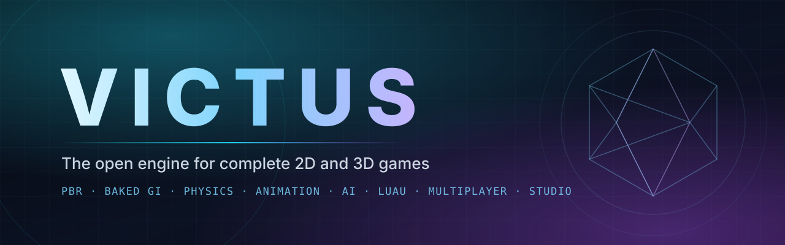
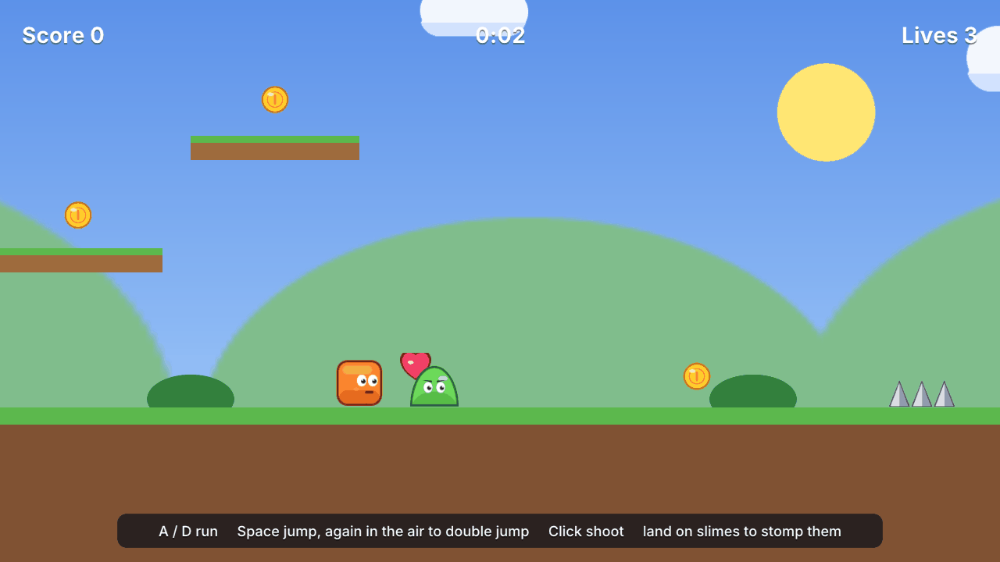
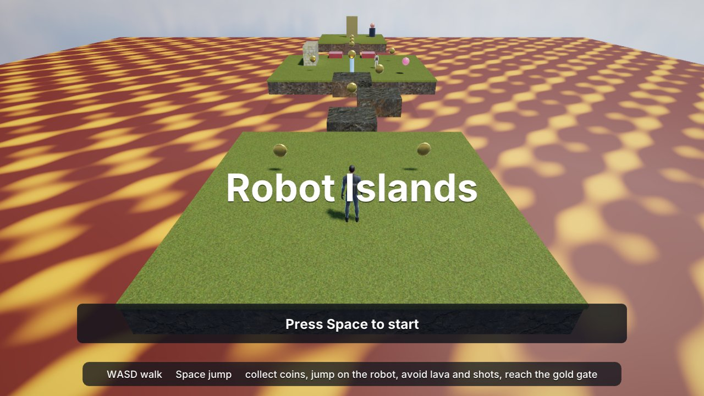
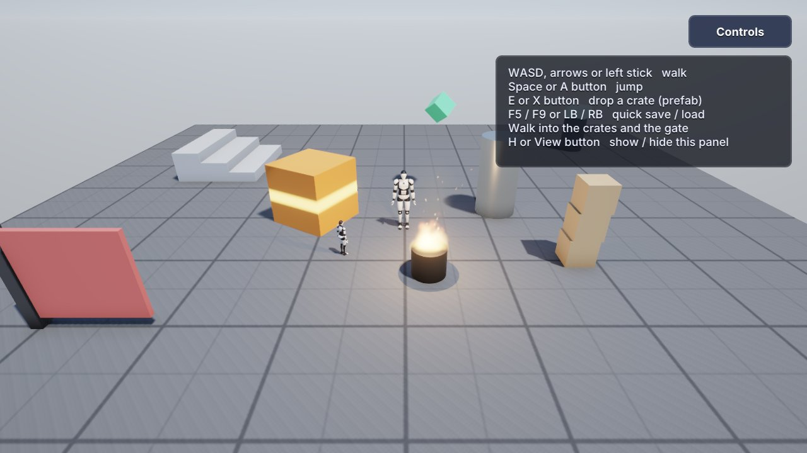
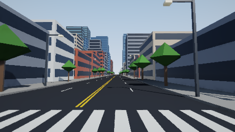
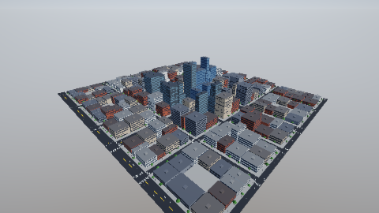

<div align="center">



### Make a whole game, 2D or 3D, without writing code.<br>Drop down to Luau, visual graphs or C++ whenever you want.

[](https://github.com/FAHTHIZ/VICTUS/actions/workflows/ci.yml)
[](LICENSE)


**[Get started](docs/GETTING_STARTED.md)** &nbsp;·&nbsp; **[User guide](docs/USER_GUIDE.md)** &nbsp;·&nbsp; **[Samples](#samples)** &nbsp;·&nbsp; **[Features](#whats-inside)** &nbsp;·&nbsp; **[Status](#status)** &nbsp;·&nbsp; **[Roadmap](ROADMAP.md)**

<br>


<sub><b>VICTUS Studio</b> — hierarchy, live viewport, inspector and the Getting Started guide</sub>

</div>

<br>

VICTUS is an independent, open engine for complete games, real-time rendering and simulation. It ships with **VICTUS Studio**, an editor built so a first-time creator can finish a game, and a full engine underneath: physically based rendering with baked global illumination, Jolt and Box2D physics, navigation, behaviour-tree AI, skeletal animation, spatial audio, server-authoritative multiplayer, Luau scripting, visual scripting and one-command export.

<table>
<tr>
<td width="33%" valign="top">

#### No code required
Ready-made **Behaviours** cover movement, enemies, pickups, health, checkpoints, score and HUD. One click turns any object into a Player, Enemy, Coin or Door.

</td>
<td width="33%" valign="top">

#### Photoreal, scaled to the device
Clustered PBR, clear coat and sheen layers, baked directional lightmaps, IBL, SSR, volumetrics and temporal upscaling, with tiers from phones to desktops.

</td>
<td width="33%" valign="top">

#### Ship it
`victus export` builds compressed, signed `.vpak` packs and a standalone player. Android packaging, crash reports and validation are built in.

</td>
</tr>
</table>

## Your first game in five minutes

No programming. Every step happens in VICTUS Studio.

| | Step | What to do |
|:-:|---|---|
| **1** | **Create a project** | Open `victus_editor`, choose **New Project**, pick **No-Code Platformer**, press **Create**. Terminal: `victus new MyGame --template nocode` |
| **2** | **Press Play** | The level is already a game: run with A/D, jump with Space (again in the air to double jump), stomp slimes, collect coins, reach the flag |
| **3** | **Change the feel** | Stop, select **Player**, edit **Platformer Movement** in the Inspector. Raise Jump Speed or set Max Jumps to 3. Every field has a tooltip |
| **4** | **Add something new** | Select any object, **Add Component › Behaviours**, pick **Patrol**, **Chase**, **Hazard**, **Collectible** or **Spawner**. It works as soon as you press Play |
| **5** | **Ship it** | **File › Export Game** writes a standalone build you can send to friends |

In the Inspector, **Make it a...** turns any selected object into a Player, Enemy, Coin, Hazard, Checkpoint, Goal, Moving Platform, Key, Door, Sign, Switch, Jump Pad or Talker. Selecting an object draws what it will do right in the viewport: patrol routes, lift paths, chase ranges and jump arcs. The **Getting Started** panel walks you through these steps, ticks each one off, can do a step for you, and its lessons build a whole first 2D or 3D game with you in seven steps.

<table>
<tr>
<td width="50%"><br><sub><b>No-Code Platformer</b> — built only from Behaviours, no scripts</sub></td>
<td width="50%"><br><sub><b>No-Code 3D Adventure</b> — islands, lava, a guard and a turret, still no scripts</sub></td>
</tr>
<tr>
<td width="50%"><br><sub><b>3D template</b> — character controller, physics, particles, prefabs, save games</sub></td>
<td width="50%"><br><sub><b>Procedural city</b> — generated streets, buildings and traffic</sub></td>
</tr>
</table>

## Behaviours

Ready-made gameplay components, in the spirit of GDevelop and Construct behaviours. Add one to an entity and it starts acting that way.

| Make it move | Make it a threat | Make it reward | Run the game |
|---|---|---|---|
| Platformer Movement | Hazard (damage, knockback, stomp) | Collectible (score, health, lives) | Game Rules (score, lives, timer, HUD) |
| Top-Down Movement | Patrol | Checkpoint | Goal |
| Camera Follow | Chase | Health | Spawner |
| Projectile | Shooter | Lifetime | Events for scripts and graphs |
| Moving Platform | Jump Pad | Trigger (signs, switches, keys, doors, conversations) | Pause (Escape) |

Every behaviour sends events (`collected`, `died`, `bounced`, `triggered`, `talked`, `game_won` and more), so scripts and visual graphs can react to them later without replacing them. Reference: [Make a game without code](docs/USER_GUIDE.md).

## What's inside

<table>
<tr><td width="22%"><b>Rendering</b></td><td>SDL_GPU render graph (Vulkan, Metal, D3D12) and an OpenGL ES 3 fallback · clustered forward PBR with clear coat and sheen layers · cascaded and local shadows · baked directional lightmaps, shadowmasks and light probes (CPU path tracer) · IBL, physical sky and atmosphere · reflection probes and screen-space reflections · SSAO · TAA and temporal upscaling · bloom, auto exposure, lens effects · volumetric fog and clouds · water, rain and snow coverage · decals, area lights and cookies · terrain and foliage · GPU particles · LODs, occlusion culling, retained instancing · device-class quality tiers</td></tr>
<tr><td><b>Gameplay</b></td><td>Archetype ECS · prefabs · scenes with stable IDs · input actions with gamepad support · 2D and 3D character controllers · save games · localisation · in-game UI with shaping and right-to-left text · world streaming · procedural generation</td></tr>
<tr><td><b>Physics</b></td><td>Jolt (3D) and Box2D (2D) · joints and motors · triggers · convex and mesh colliders · ragdolls · cloth · destruction</td></tr>
<tr><td><b>AI</b></td><td>Recast/Detour tiled navmeshes and crowds · behaviour trees with perception, a visual editor and a debugger · traffic simulation</td></tr>
<tr><td><b>Animation</b></td><td>GPU linear and dual-quaternion skinning · state machines and blend spaces · IK · layers and masks · retargeting · morph targets and corrective shapes · timeline sequencer</td></tr>
<tr><td><b>Audio</b></td><td>miniaudio with spatial sound · six buses · voice budgets and virtual voices · occlusion, reverb zones, underwater filtering</td></tr>
<tr><td><b>Studio</b></td><td>Start screen with templates and samples · saved layouts · gizmos · undo and redo · searchable Add Component · asset browser with drag-and-drop import · play-in-editor · material graphs · terrain tools · Problems panel · command palette · profiler · one-click export</td></tr>
<tr><td><b>Code</b></td><td>Luau scripting with sandboxing and hot reload · node-based visual scripting · a C++ API · native plugins with a versioned C ABI</td></tr>
<tr><td><b>Multiplayer</b></td><td>Server-authoritative sessions over ENet, encrypted by default · listen servers and dedicated <code>victus serve</code> · in-editor host and clients</td></tr>
<tr><td><b>Shipping</b></td><td><code>victus export</code> to compressed, signed <code>.vpak</code> packs and a standalone player · Android packaging · crash reports and diagnostics bundles · <code>victus check</code> validation · asset library with licence tracking</td></tr>
</table>

## Templates

| Template | Command | You get |
|---|---|---|
| No-Code Platformer | `victus new MyGame --template nocode` | A complete 2D level made only from Behaviours |
| No-Code 3D Adventure | `victus new MyGame --template nocode3d` | A 3D island level with an animated character, made only from Behaviours |
| 2D platformer | `victus new MyGame --template 2d` | Box2D platformer in Luau: one-way ledge, swinging lantern, coins, music |
| 3D | `victus new MyGame --template 3d` | Third-person Orion (or Nova): armoured Frame characters with a 60-joint rig, emissive trims, a blend-shape face display and 41 clips, physics crates, fire, prefabs, save and load |
| Simulation | `victus new MyGame --template simulation` | 576 entities animated by native systems, with a scripted orbiting camera |
| Multiplayer | `victus new MyGame --template multiplayer` | Networked coin arena: host with `victus serve`, join with `victus run --connect` |

## Samples

Each sample is a finished game made with engine features alone. Open it in Studio or run `victus run samples/<name>`. CTest plays every sample to the end headlessly (`ctest -L samples`).

<table>
<tr>
<td width="50%"><br><sub><a href="samples/arena/README.md"><b>Robot Arena</b></a> — five waves of rogue androids that chase you over the navmesh</sub></td>
<td width="50%"><br><sub><a href="samples/dungeon_crawler/README.md"><b>Dungeon Crawler</b></a> — generated tilemap floors, gems and slimes</sub></td>
</tr>
<tr>
<td width="50%"><br><sub><b>Render Showcase</b> — the 3D material and lighting feature set</sub></td>
<td width="50%"><br><sub><b>City from above</b> — the procedural city generator at scale. <a href="samples/platformer/README.md"><b>Ruin Runner</b></a>, a three-level 2D platformer, ships alongside</sub></td>
</tr>
</table>

## Quick start

```bash
tools/setup/install_deps.sh          # Linux/macOS toolchain (Windows: see the guide)
python3 tools/setup/check_env.py     # verify the toolchain
cmake --preset dev && cmake --build --preset dev && ctest --preset dev

B=build/dev/bin
$B/victus new MyGame --template nocode   # or nocode3d, 3d, 2d, simulation, multiplayer
$B/victus_editor MyGame                  # open it in VICTUS Studio
$B/victus run MyGame                     # or play it directly
$B/victus export MyGame --out MyGame-export && ./MyGame-export/MyGame
```

CMake fetches dependencies from pinned, hash-verified archives; no account or sign-in is needed. Presets, Windows notes and troubleshooting are in [Getting started](docs/GETTING_STARTED.md).

> [!TIP]
> **Controls.** 2D: A/D or arrows to run, Space to jump. 3D: WASD to walk, Space to jump. Multiplayer: WASD and Space, with coins scored by the server. A gamepad works too. In Studio, click the viewport after pressing Play so the game receives the keyboard.

## Status

> [!IMPORTANT]
> VICTUS is a **pre-release engine**. No public release or externally shipped game is recorded yet.

Rendering tests run on Mesa lavapipe (software Vulkan), Mesa GLES and CI's virtualised Apple GPU; those results do not establish performance on physical GPUs. The Android player is packaged in CI, but no install on an emulator or physical phone is recorded, so frame rate, memory, thermals, battery and input on Android remain unverified. Automated tests prove the specific cases they exercise, not visual polish or production readiness on every device. Use the dated evidence:

| Document | What it tells you |
|---|---|
| [Visual quality and performance gap register](docs/VISUAL_QUALITY_AND_PERFORMANCE_GAP_REGISTER.md) | Prioritised work for high visual quality and measured performance |
| [Known limitations](docs/KNOWN_LIMITATIONS.md) | Current subsystem maturity and concrete limits |
| [Platform support](docs/PLATFORM_SUPPORT.md) | What has actually been built and run on each platform |
| [Engineering status](docs/STATUS.md) | Implementation and verification evidence for every change |
| [Roadmap](ROADMAP.md) · [Changelog](CHANGELOG.md) | What is next and what changed |

## Documentation

| | |
|---|---|
| **Using VICTUS** | [Getting started](docs/GETTING_STARTED.md) · [User guide](docs/USER_GUIDE.md) · [Gameplay AI](docs/AI.md) · [Animation](docs/ANIMATION.md) · [Sequencer](docs/SEQUENCER.md) · [Characters](docs/CHARACTERS.md) · [Plugins](docs/PLUGINS.md) · [Android](docs/ANDROID.md) · [Diagnostics](docs/DIAGNOSTICS.md) |
| **Contributing** | [CONTRIBUTING.md](CONTRIBUTING.md) · [Architecture](docs/ARCHITECTURE.md) · [Technology decisions](docs/TECHNOLOGY_DECISIONS.md) · [Release process](docs/RELEASE_PROCESS.md) · [Third-party licenses](docs/THIRD_PARTY_AND_LICENSES.md) · [Security](SECURITY.md) · [Engineering contract](AGENTS.md) |
| **Specifications** | [Gameplay](docs/GAMEPLAY_SPEC.md) · [Rendering](docs/RENDERING_SPEC.md) · [Networking](docs/NETWORKING_SPEC.md) · [Production pipeline](docs/PRODUCTION_PIPELINE_SPEC.md) · [Editor](docs/EDITOR_SPEC.md) · [Performance](docs/PERFORMANCE_STRATEGY.md) · [Platforms](docs/PLATFORM_STRATEGY.md) · [Reference projects](docs/REFERENCE_PROJECTS.md) · [Research register](docs/RESEARCH_REGISTER.md) |

## Repository layout

| Path | Contents |
|---|---|
| `engine/<module>/` | Engine modules (`core`, `platform`, `rhi`, `render`, `ecs`, `scene`, `assets`, `physics`, `script`, `net` and more), each with `include/victus/<module>/` and `src/`. See [Architecture](docs/ARCHITECTURE.md) |
| `editor/` | VICTUS Studio |
| `apps/player/`, `platforms/android/` | Standalone game player and the Android Gradle project |
| `tools/` | The `victus` CLI, shader compiler, dependency scanner, lint, setup and release scripts |
| `samples/`, `tests/`, `benchmarks/` | Sample games, automated tests (CTest) and benchmarks |
| `docs/` | Guides, specifications, decisions and status |

## License

Original VICTUS code is licensed under [Apache-2.0](LICENSE). Third-party components keep their own licenses and notices; see [docs/THIRD_PARTY_AND_LICENSES.md](docs/THIRD_PARTY_AND_LICENSES.md).

<div align="center">
<br>
<sub>Built by <a href="https://github.com/FAHTHIZ">FAHTHIZ</a> · VICTUS</sub>
</div>
