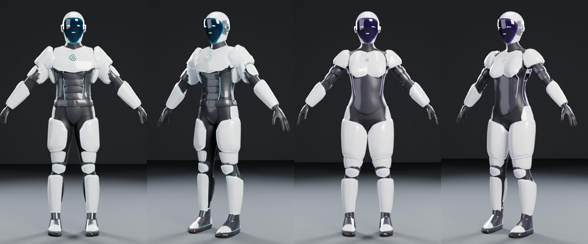
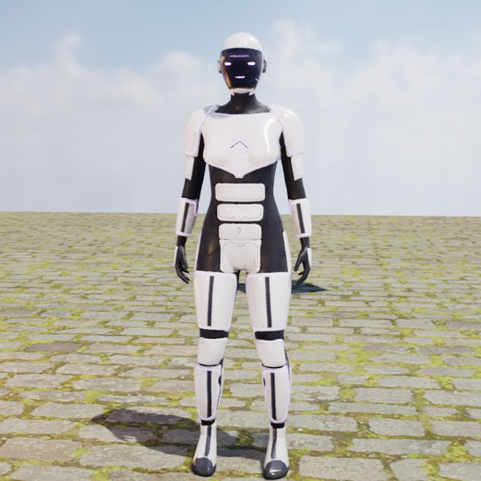

# VICTUS Characters — the character pipeline, Orion and Nova

The 3D and multiplayer templates ship two VICTUS characters, **Orion** and **Nova**: Frame
mannequins - armoured sci-fi test dummies in the spirit of Unreal's Manny and Quinn - built by the
VICTUS character pipeline (`tools/characters`, ADR-0198; helmeted redesign ADR-0204) from the CC0 MakeHuman base mesh. They
share one skeleton layout, one clip library, one animation controller and one set of gameplay
scripts; swapping one for the other changes the look and proportions, not the behaviour. They
replace the realistic human pilots of ADR-0179 (which replaced the signed-distance-field androids
of ADR-0121 and the Vanguard robots of ADR-0069). Asset ids, file paths, UUIDs, joint names,
sockets and clips are unchanged, so existing projects keep their references.

| | Orion | Nova |
|---|---|---|
| Id (CLI / launcher) | `orion` (default) | `nova` |
| Model | `assets/models/characters/victus_orion.glb` | `assets/models/characters/victus_nova.glb` |
| Stable UUID (`.meta`) | `8e84eb12-63c8-4aed-aae2-517c038d3071` | `44037d0d-1627-44a8-a225-633971f196b2` |
| Skeleton profile | `VictusHumanoid.Orion` | `VictusHumanoid.Nova` |
| Build | masculine, heroic athletic (MakeHuman macro: gender 1.0, muscle 0.92, weight 0.46) | feminine, slender (gender 0.0, muscle 0.62, weight 0.38) |
| Design | Frame 01 | Frame 02 |
| Look | graphite composite undersuit, glazed white ceramic plates, brushed-metal fasteners, black glass visor, cyan light, blue-tinted visor | graphite composite undersuit, glazed pearl ceramic plates, silver hardware, black glass visor, violet light, violet-tinted visor |
| Height (floor to top of the helmet) | 1.78 m | 1.69 m |
| Triangles (LOD 0, as exported) | 187,672 | 181,880 |
| GLB size | 14.01 MB | 13.65 MB |

Both stand on Y = 0, face +Z with their left on +X, and are authored in the A-pose the earlier
characters used (arms 40 degrees from vertical), so existing clips and ragdoll setups line up.

Why a mannequin: a realistic human needs skin, eye and hair shading (subsurface scattering, strand
hair) the renderer does not have yet, and falls into the uncanny valley without it. A mannequin
shows what the engine does well - layered PBR (clear-coated ceramic, composite fabric, brushed
metal, glass), emissive trims with bloom, normal-mapped detail, skinning and blend shapes - and reads as
a deliberate design, the way engine sample characters usually are.

## What a character contains

Each GLB is self-contained (no external buffers or images). One skinned mesh node
`<Name>_Body` carries three primitives, one per material, so a character costs three skinned draws
per pass:

| Material | Part | Maps | Notes |
|---|---|---|---|
| `<Name>_Frame` | undersuit body (neck to ankles, both hands) | base colour, normal, ORM, emissive | 2048²; the MakeHuman body smoothed (10 Taubin passes: the proportions and V-taper survive, the anatomical detail does not; the fingers keep their shape); a hexagonal micro-weave split into moulded panels that follow the muscles (`suit.py`: pectorals or bust, a rectus grid or corset, obliques, collar, trapezius, shoulder blades, erectors, lumbar, glutes, deltoids, biceps, triceps, forearms, quadriceps, vastus, hamstrings, calves, shins), each with a recessed seam along its outline and a low moulded crown inside it (0.55 of the authored relief: a manufactured suit, not a muscle suit); thin light lines down the sides of the abdomen into the hips, under the pectorals or bust, along the shoulder blades and down the flanks; ribbed flex zones at the neck, shoulders, elbows, wrists, waist and knees; recessed piping down the outside of every limb carrying a light line; undersuit faces fully covered by a plate are removed |
| `<Name>_Armor` | helmet, sculpted plates, boots, ear pods, back core, chest emblem | base colour, normal, ORM, emissive; clear coat 0.65 (roughness 0.06) | 2048²; the helmet is the convex hull of the head's blurred volume, puffed out and shrink-wrapped by a 27x27-per-face quad cube-sphere, smoothed, with a shield-shaped visor opening, brushed-metal side panels around the ear pods framed by a recessed seam, a crest ridge and vents; plates (`plates.py`) are outlines on front, back, side, limb and sphere charts grown into near-uniform shells (a 18 mm bevel to full thickness, the base faired and the outer surface refit as a cubic panel over its chart so the surface is manufactured rather than anatomical, larger plates pulled onto planes, the lip rolled under along a creased, hard-shaded rim): Orion has one angular breastplate from shoulder to shoulder with a chevron lower edge, four graphite abdominal lames with gaps between them, obliques, belt, groin, hips, shoulder-blade plates and a spine housing; Nova has a bust plate split by a lit seam, one smooth graphite corset front and back, hip flares, blades and spine housing; both have pauldrons kept clear of the chest, a lame, biceps band, elbow cop, slanted gauntlets, thigh and hamstring plates, knee cops, shins and calves, 6-30 mm thick; panel lines, graphite inserts and metal fasteners; rounded bevels and an inset groove 8 mm in from every edge with a light strip on the trimmed plates; boots with a moulded lug sole and ceramic toe caps and heels; machined-metal ear pods with light rings, a back core with glowing rings and a hexagonal chest emblem |
| `<Name>_Visor` | visor glass and face display | base colour, normal, ORM, emissive; clear coat 1.0 (roughness 0.02) | 1024²; one pane of smoked glass on a sphere chart around the head, a shield outline from the brow to the chin wrapping back to the ear pods (Nova's 8% narrower), its edge rolled into the helmet; a thin tinted glow bleeds in from the rim (cyan or violet) and the centre stays near-black; arc eye glyphs and a mouth bar lie on the glass, driven by blend shapes |

Emissive strengths (`KHR_materials_emissive_strength`): Frame 3, Armor 4, Visor 6, so the trims
bloom in the post stack. All maps are baked from the actual surface (per-texel world position and
normal, a Cycles ambient-occlusion bake against the whole character) - there are no flat material
colours and no placeholder textures. Every material is opaque (no alpha). Armor and Visor carry
`KHR_materials_clearcoat` factors, which the engine imports as a clear coat layer (ADR-0203): a
sharp glossy reflection over the satin ceramic and the glass. The engine's texture
cooker builds mips and GPU block compression (BC7/ASTC) at import like any other model.

Blend shapes: every primitive lists the same 26 face-display targets (`eyeBlink_L/R`,
`eyeWide_L/R`, `eyeSquint_L/R`, `browDown_L/R`, `browInnerUp_L/R`, `browOuterUp_L/R`,
`cheekSquint_L/R`, `jawOpen`, `mouthSmile_L/R`, `mouthFrown_L/R`, `mouthStretch_L/R`,
`mouthPucker`, `mouthRollUpper`, `mouthRollLower`, `mouthUpperUp`, `mouthLowerDown`); only the
Visor's glyphs move (the eye glyphs close, widen, squint and tilt like brows; the mouth bar opens,
curves and purses). The names are the ARKit ones the human characters used, so facial clips and
scripts keep working. Morph deltas are sparse and stored as normalised integers
(`KHR_mesh_quantization`), which the importer reads natively.

## Skeleton

60 joints, identical names, order and hierarchy in both characters (the bind poses differ, one
per skeleton profile):

- Joints 0-20 are the original 21-joint humanoid, in the original order: `Hips, Spine, Chest,
  Neck, Head, Shoulder.L, UpperArm.L, LowerArm.L, Hand.L, Shoulder.R, ... Hand.R, UpperLeg.L,
  LowerLeg.L, Foot.L, Toe.L, UpperLeg.R, ... Toe.R` (`project::kCharacterCoreJointCount`). Scripts,
  ragdoll maps, foot IK and retargeting written for that layout keep working.
- Per side: `UpperArmTwist`, `LowerArmTwist`, `UpperLegTwist` (twist joints that take part of the
  roll so forearms and thighs do not candy-wrap), and `Thumb1-3`, `Index1-3`, `Middle1-3`,
  `Ring1-3`, `Pinky1-3`.
- `Jaw`, `Eye.L`, `Eye.R`.

Skin weights come from MakeHuman's 163-bone reference weights, collapsed onto this layout and
limited to four influences (stored as normalised bytes); every armour vertex keeps the weights of
the body vertex it was grown from, so plates follow the body they cover. The helmet, visor
and ear pods are rigid on `Head`; `Jaw` and `Eye.L/R` remain for retargeting and attachments. Clips store rotations plus the Hips
translation, so one clip drives both profiles.

Extra bones (facial, toes, roll, IK targets and poles, secondary motion, equipment) are added with
a skeleton migration rather than by changing the GLBs (docs/ANIMATION.md, "Extending skeletons";
ADR-0206). Adding 19 such bones to Orion leaves every existing joint index, socket and clip in
place and moves no vertex of any of the 41 clips by more than 0.001 mm, and the extended model
still passes character validation.

## Sockets

Attachment points are named child nodes. Their frames follow one convention so equipment
authored for one character fits the other:

| Node | Parent | Frame |
|---|---|---|
| `Socket.Root` | `Rig` | ground, character facing |
| `Socket.Head` | Head | top of the helmet, character facing (hats, crests, antennae) |
| `Socket.Face` | Head | 3 cm in front of the eyes (visors, glasses) |
| `Socket.Back` | Chest | 2 cm behind the back plate (backpacks, weapons) |
| `Socket.Hand.L`, `Socket.Hand.R` | Hand.L / Hand.R | grip centre; +Y along the fingers, +Z out of the palm |
| `Socket.Hip.L`, `Socket.Hip.R` | Hips | outside of each hip (holsters, pouches) |

Attach something with `character:attach(item, "Socket.Hand.R")` in Luau (it snaps the item to the
socket and returns the socket node, or `nil` when the character has no such socket; pass `true` as
a third argument to keep the item's world placement), `Scene::attach_to_socket` in C++, or by
dragging an entity onto the node in the Hierarchy. `entity:find_descendant(name)` finds any nested
node; `find_child` only looks at direct children, and sockets sit inside the skeleton.

## Clips and controller

The library has 41 clips sampled at 30 fps, generated from parametric gait and pose code
in `tools/characters/anim.py`. The original seven keep their names, lengths and phases:

| Clip | Length | Loop |
|---|---|---|
| Idle | 4.0 s | yes, breathing, a head glance, blinks |
| Walk | 0.8 s | yes |
| Run | 0.55 s | yes, phase-synced with Walk |
| Jump | 0.6 s | one-shot |
| Fall | 0.8 s | yes |
| Land | 0.4 s | one-shot |
| Interact | 0.9 s | one-shot hand reach |

Added: `Idle_Look`, `Idle_Shift`; strafes and backpedals `Walk_Back/Left/Right`,
`Run_Back/Left/Right`; `Sprint`; transitions `Walk_Start/Stop`, `Run_Start/Stop`,
`Turn_Left_90`, `Turn_Right_90`, `Land_Hard`; crouch `Crouch_Idle`, `Crouch_Walk(_Back/_Left/_Right)`,
`Crouch_Enter/Exit`; actions `Pickup`, `Wave`, `Point`, `Aim`; hand poses `Grip_L`, `Grip_R`; and
facial clips `Face_Blink`, `Face_Talk`, `Face_Smile`, `Face_Frown`, `Face_Surprise` (blend-shape
and jaw/eye channels only, for an upper or face layer; on the mannequins they animate the face
display, `jawOpen` following the jaw angle). The GLB's `extras.victus.clips` lists each
clip with its length, loop flag and layer.

`assets/anim/characters/victus_locomotion.vanim` drives both characters. Parameters: `speed`
(m/s), `grounded` (default true), triggers `jump` and `interact`, and the int `expression` for the
`Face` layer (ADR-0222).

- `Locomotion`: 1D blend of Idle (0), Walk (2.5) and Run (5).
- `jump` from Locomotion, Land or Interact enters `Jump`; after it, `Fall` loops while airborne.
- Leaving the ground without jumping also enters `Fall`.
- Touching down enters `Land`, which returns to `Locomotion`.
- `interact` (E / gamepad West in the templates) plays `Interact` and returns to `Locomotion`.
- The `Face` layer plays the facial clips over every base state: `expression` 0 `Face_Blink`
  (neutral, the default), 1 `Face_Talk`, 2 `Face_Smile`, 3 `Face_Frown`, 4 `Face_Surprise`, each
  cross-faded over 0.25 s. They animate only the face display (and the jaw and eye joints), so the
  body keeps the locomotion pose: `entity:set_anim_param("expression", 2)` smiles while running.

## Equipment

The mannequins carry no separate equipment nodes (the human pilots' boots, gloves, belt and
backpack of ADR-0179 are gone; the boots and hand plates are part of the armour). Gear attaches
through the [sockets](#sockets); `Socket.Back` sits behind the back plate, clear of the back core.
To hide armour in a script, untick Visible on `<Name>_Body[1]` (the Armor primitive) or call
`set_visible(false)` on it.

Measured on both characters (ADR-0222, `victus_asset_tests -tc="character equipment*"`): over
369 poses of all 41 clips, the distance from each of the seven body sockets to the skinned surface
that carries it changes by at most 2.3 mm (`Socket.Hip.L` in `Crouch_Walk_Left`), so worn and held
props stay on the deforming armour; a prop attached with `attach_to_socket` follows its socket
exactly every frame, also when skeleton LOD has eased the fingers out. In the runtime renderer a
prop in `Socket.Hand.R` is drawn where the GPU-skinned hand puts it in every pose of `Run`.

## LODs and budgets

LOD 0 is one Catmull-Clark subdivision of the quad meshes (about 185k triangles: the high-end PC
budget, with clean edge loops at the shoulders, elbows, knees and fingers and smooth plate
bevels). The importer generates three coarser LODs with meshoptimizer
(`ModelImportSettings::lods`), and per-cascade shadow LOD applies as for any model. Templates
scale the character to the gameplay capsule (player 1.45 m) uniformly, keeping Orion taller than
Nova.

## How they are made

```
python3.11 -m venv /tmp/bpyenv
/tmp/bpyenv/bin/pip install bpy==5.0.1 numpy scipy pillow
/tmp/bpyenv/bin/python tools/characters/test_pipeline.py
/tmp/bpyenv/bin/python tools/characters/build_characters.py --out engine/project/data/characters
```

The full build takes about 11 minutes on two cores (most of it is per-texel baking and the Cycles
AO bake); `--only orion --size 0.25 --no-ao` gives a quick preview in under a minute. Output is
deterministic for one environment. Stages:

| Module | Stage |
|---|---|
| `mh.py` | MakeHuman loaders: base mesh (`hm08`), macro targets (gender, muscle, weight, ethnic mix), proxy fitting (`.mhclo`), the reference rig and weights, facial pose units (BVH) |
| `fit.py` | shapes the body from the character's `Spec`, poses it into the A-pose, collapses the reference rig onto the 60-joint layout, converts to VICTUS space |
| `suit.py` | the undersuit's panel layout (outlines on the plate charts) and light lines |
| `plates.py` | sculpted armour plates: outlines on front, back, side and limb charts grown into crowned shells |
| `render_preview.py` | Cycles studio renders of the GLBs for review (`--views front,three,side,back,head,...`, `--suit` for the undersuit alone, `--pose squat|reach|Clip@seconds` stress poses, `VICTUS_CLAY=1` untextured geometry, `--lineup`) |
| `mannequin.py` | the Frame mannequin: smooths the body, builds the helmet from the convex hull of the head's blurred occupancy volume (`HullSurface`), grows the armour plates (`plate_regions`: planes plus a bone-segment radius per plate; `gear.shell` offsets them along the rest normal and rolls the cut edges under), boots, ear pods and back core, the visor and the face-display glyphs with their blend shapes, and repacks UV islands; `Style` holds each character's colours |
| `assemble.py`, `gear.py` | shared helpers: `Part`, joint maps, shells, boots, rounded boxes (the human pilots' skin/suit/groom assembly of ADR-0179 is kept for reference but no longer built) |
| `meshops.py` | Catmull-Clark subdivision as a sparse operator (weights and morphs subdivide with the positions), GPU vertices and tangents |
| `mannequin_materials.py`, `bake.py` | per-texel material functions (Frame, Armor, Visor), height → normal conversion, Cycles AO bake, encoding |
| `anim.py` | the clip library |
| `gltf.py`, `build_characters.py` | skeleton frames, sockets, clips and the GLB writer; `characters.build.json` records each output's size, SHA-256 and counts |

To make a new character, add a `Spec` (macro values) in `fit.py` and a `Style` (undersuit, plate,
accent, metal, light and glass colours, plate and undersuit roughness) in `mannequin.py`, then
build it. Plate layout changes go in `plates.layout`, undersuit panels in `suit.panels`. Review renders:
`/tmp/bpyenv/bin/python tools/characters/render_preview.py --glb <glb> --views front,three,back` (add
`--suit` for the undersuit alone; build with `VICTUS_KEEP_SUIT=1` to keep the undersuit faces under
the plates for that review).

The GLBs under `engine/project/data/characters` are embedded into the engine at build time
(`cmake/EmbedBinary.cmake`, assembler `.incbin` on GCC/Clang, byte arrays on MSVC) and written
into new projects by the templates.

## Validation

- `tools/characters/test_pipeline.py`: subdivision operator, tangent handedness, quaternions,
  quantised sparse morphs and byte weights, the skeleton layout's backward compatibility, the clip
  library's original durations.
- `victus_asset_tests` "starter characters" cases: zero importer warnings, three opaque materials
  each with albedo, normal, ORM and emissive textures, 140k-190k triangles, 26 blend shapes on
  every part, 60 joints
  with the original 21 first, the per-character height, the original seven clips with their
  lengths, every socket under its parent, and the shared controller driving Idle, Walk, Jump,
  Fall, Land and Interact on the imported model.
- `victus_asset_tests` "character validation": both starters pass `project::validate_character`
  with no errors or warnings; a renamed core joint, reordered skin joints, a missing socket, a
  missing controller clip and centimetre units are each reported.
- `victus_scene_tests` "find_descendant and attach_to_socket" and `victus_script_tests` "scene,
  entity and input API": nested socket lookup and attachment from C++ and Luau.
- `victus_gpu_tests` "gpu character lods": Orion rendered by the VICTUS renderer in four poses at
  2.5, 8 and 20 m, LOD image against LOD 0 image.

### Renders

Blender render (Cycles, the shipped GLBs imported into Blender 5.0, studio lighting; not the
VICTUS renderer): Orion and Nova, each front and three-quarter.




VICTUS runtime (the engine's own renderer: `victus run --frames 40 --quality ultra --screenshot` on a fresh 3D template, with the follow camera replaced by a fixed camera 2.6 m in front, the HUD removed and the brazier moved out of frame; lavapipe):




### Validating a character

`victus character-check <model>` imports a `.glb`, `.gltf` or `.fbx` (or `orion` / `nova`, the
embedded starters) and checks that it can replace a starter character without script, controller
or template changes:

- errors: no skin; a core joint missing, out of the original order or under the wrong parent; a
  socket missing; one of the controller clips (Idle, Walk, Run, Jump, Fall, Land, Interact)
  missing or empty; weights pointing outside the skin; a bind-pose height outside 1.2-2.4 m
  (usually centimetre units or a Z-up export);
- warnings: a joint count other than 60 (`--any-joints` silences it), a socket under an
  unexpected parent, unskinned meshes, weights that do not sum to 1, feet off the ground, more
  than 20k triangles without LODs, materials without a base colour texture or normal map, and
  importer warnings.

It prints a summary line, one line per issue and `OK` or `FAILED` (exit code 1 on errors, or on
any issue with `--strict`); `--json` prints the same report as JSON for CI. The checks are
`project::validate_character` in `engine/project/src/character_validate.cpp`.

## Choosing a character

- CLI: `victus new MyGame --template 3d --character nova` (`orion`, `nova` or `none`).
- Launcher: the New Project form shows a Character choice (Orion, Nova, None) for templates that
  have a player character.
- Studio: Add > Characters (or the command palette's "Entity: Add Orion/Nova") adds either one at
  the camera focus; Ragdoll Lab adds both as ragdolls.
- `none` keeps the capsule body and writes no character files.

## Licensing and provenance

The base mesh, targets, reference rig, weights, facial pose units, eye and eyelash geometry come
from MakeHuman's asset library, released under CC0 1.0 (vendored unmodified, gzip-compressed, in
`third_party/makehuman`, commit `a8bc2d54ff0ac92e78ff71431b1023eda42bf482`; see its README). The
MakeHuman application code (AGPL-3.0) is not used or included. Everything else - the mannequin
geometry, armour, visor, materials, textures, sockets, clips and the pipeline - is original
VICTUS work, Apache-2.0.
Blender (`bpy`, GPL) is a build-time tool for the AO bake only; its output belongs to the user
([Blender license](https://www.blender.org/about/license/)). See ADR-0069, ADR-0121, ADR-0179, ADR-0198 and ADR-0204.
